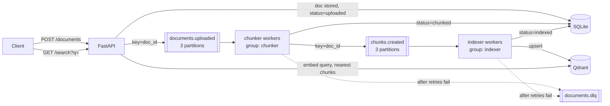

# Real-time document ingestion (RAG) with FastAPI + Kafka

Upload a document and it is chunked, embedded and indexed asynchronously through Kafka,
then searchable through a vector database. Built to learn the parts of Kafka that matter
in real systems: partitions and keys, consumer groups, manual offset commits, retries and
a dead-letter topic.

## Architecture



| Piece | Role |
|---|---|
| `app/api.py` | Upload endpoints, document status, search, delete |
| `app/chunker_worker.py` | `documents.uploaded` → overlapping chunks → `chunks.created` |
| `app/indexer_worker.py` | `chunks.created` → embedding → Qdrant, tracks progress |
| `app/kafka_utils.py` | Shared consumer loop: manual commits, retries with backoff, DLQ |
| `app/db.py` | SQLite document/progress state (shared volume) |
| `frontend/` | Next.js UI: upload files/text, live document status, search, statistics |

## Kafka concepts it demonstrates

- **Keys and partitions:** messages are keyed by `doc_id`, so everything for one document stays on one partition, in order.
- **Consumer groups:** `chunker` and `indexer` are separate groups. Scale either one and Kafka splits the 3 partitions between the copies.
- **At-least-once delivery:** offsets are committed only after a message is processed.
- **Idempotent processing:** because messages can be delivered twice, Qdrant point ids are deterministic (`uuid5(doc_id:chunk_index)`) and SQLite progress rows are `INSERT OR IGNORE`. Reprocessing never creates duplicates.
- **Retries and dead letters:** each message is tried 3 times with exponential backoff, then sent to `documents.dlq` and the document is marked `failed` with the reason.

## Run it

Needs Docker.

```bash
docker compose up -d --build
```

This starts Kafka (KRaft, no Zookeeper), creates the three topics with 3 partitions each, Qdrant, Kafka UI, the API, and one chunker and one indexer.

| URL | What |
|---|---|
| http://localhost:3000 | Web UI: upload documents, watch status, search |
| http://localhost:8000/docs | Swagger UI for the API |
| http://localhost:8080 | Kafka UI: topics, partitions, messages, consumer groups |
| http://localhost:6333/dashboard | Qdrant dashboard |

## Try it

Open http://localhost:3000 and upload a `.txt` / `.md` file (or paste text), then watch it move
`uploaded → chunked → indexed` and search the results.

Or by hand:

```bash
curl -X POST http://localhost:8000/documents -F "file=@sample_docs/Portfolio/Backend/Qdrant.md"
curl http://localhost:8000/documents                       # status: uploaded -> chunked -> indexed
curl "http://localhost:8000/search?q=vector+search+database"
curl -X DELETE http://localhost:8000/documents/<doc_id>    # removes the doc and its vectors
```

Upload a whole folder with the demo script:

```bash
./demo.sh
```

## API

| Method | Path | Purpose |
|---|---|---|
| `POST` | `/documents` | Upload a `.txt` / `.md` file (multipart `file`) |
| `POST` | `/documents/text` | Ingest pasted text (`{"title", "text"}`) |
| `GET` | `/documents` | List documents (`?status=`, `?limit=`) |
| `GET` | `/documents/{doc_id}` | One document's status and chunk progress |
| `DELETE` | `/documents/{doc_id}` | Delete a document, its chunks and its vectors |
| `GET` | `/search` | Hybrid search (`?q=`, `?limit=`, `?offset=`, `?doc_id=`, `?filename=`) |
| `GET` | `/stats` / `/stats/overview` | Counts by status / dashboard aggregates |
| `GET` | `/health` | Liveness plus the active embedder |

## Things to try (these are the interesting parts)

**See consumer groups split partitions**

```bash
docker compose up -d --scale chunker=3 --scale indexer=3
```

Open Kafka UI → Consumers → `chunker` / `indexer` and watch each copy take one partition.
Stop one container (`docker stop <name>`) and watch the partitions rebalance.

**See the dead-letter topic**

Upload a file with no words in it:

```bash
printf -- '-----' > /tmp/empty.txt
curl -X POST http://localhost:8000/documents -F "file=@/tmp/empty.txt"
curl "http://localhost:8000/documents?status=failed"      # error: chunker: document has no indexable text
```

After 3 attempts the message appears in the `documents.dlq` topic (Kafka UI → Topics).

**See idempotency**

Reset the `chunker` group's offsets to the beginning in Kafka UI (stop the chunker first), start it again, and check that `GET /stats` and the Qdrant point count do not change.

## Tests

```bash
python -m venv .venv && source .venv/bin/activate
pip install -r requirements-dev.txt
pytest
```

The tests run the whole pipeline logic without Kafka or Docker: a fake producer captures
messages and they are fed into the next stage, with Qdrant in in-memory mode. They cover chunking,
SQLite progress tracking, idempotent redelivery, validation errors, Kafka being down, the retry
wrapper, and hybrid search (ranking, stemming, typo correction, snippets, dedupe, facets, pagination).

## Embeddings

The default embedder is `fastembed` (`BAAI/bge-small-en-v1.5`, 384-dim): real semantic
embeddings, so the model is downloaded from Hugging Face on first start and cached
(in Docker at `FASTEMBED_CACHE_PATH`, defaults to `/data/fastembed`). If the model can't be
loaded (offline, blocked network), the app logs a warning and falls back to the hashed
bag-of-words embedder, which is deterministic and needs no download but only matches on
shared words. Force it explicitly with `EMBEDDER=hash`.

```bash
EMBEDDER=hash docker compose up -d --build   # lexical-only, fully offline
```

Switching embedders changes the vector size. On startup the API detects the mismatch and
re-embeds every stored chunk into a rebuilt collection (a couple of seconds at demo scale);
the other workers wait until the new collection is ready.

## Search

Search is hybrid. Candidates come from both a vector search (meaning) and a cached BM25
index over the whole corpus (exact words), then the two scores are blended
(`SEARCH_LEXICAL_WEIGHT`, default `0.5`). The lexical side also

- **stems** words, so "consumer", "consumers" and "consuming" all match;
- **auto-corrects typos** against the corpus vocabulary (e.g. "consummers" → consumer);
- returns **facets** per file and supports **offset/limit pagination**.

The frontend exposes filename facet chips and a "Load more" button.

## Configuration

| Env var | Default | Meaning |
|---|---|---|
| `KAFKA_BOOTSTRAP` | `localhost:9092` | Broker address (compose sets `kafka:19092`) |
| `QDRANT_URL` | `http://localhost:6333` | Qdrant address |
| `SQLITE_PATH` | `rag.db` | SQLite file (compose uses `./data/rag.db`) |
| `EMBEDDER` | `fastembed` | `fastembed` (semantic, downloads a model) or `hash` (offline, lexical) |
| `SEARCH_LEXICAL_WEIGHT` | `0.5` | Blend of BM25 lexical score vs vector similarity (0 = pure vector, 1 = pure BM25) |
| `SEARCH_CANDIDATE_FACTOR` | `4` | Vector candidates fetched per requested result before re-ranking |
| `FASTEMBED_CACHE_PATH` | `/data/fastembed` | Where the fastembed model is cached (compose sets this) |
| `CHUNK_SIZE` / `CHUNK_OVERLAP` | `800` / `100` | Characters per chunk / overlap |
| `MAX_ATTEMPTS` / `RETRY_BACKOFF` | `3` / `1.0` | Tries per message / first backoff in seconds |
| `INDEXER_BATCH_SIZE` | `32` | Chunks embedded + upserted per batch |
| `INDEXER_BATCH_WAIT_MS` | `100` | Max time to wait for a full indexer batch |
| `PRODUCER_LINGER_MS` | `5` | Producer linger before sending (batches records) |
| `PRODUCER_COMPRESSION` | `gzip` | Producer compression codec (`none` to disable) |
| `MAX_UPLOAD_BYTES` | `500000` | Upload limit (Kafka's default message limit is about 1 MB) |
| `NEXT_PUBLIC_API_URL` | `http://localhost:8000` | API base URL baked into the frontend at build time |
| `CORS_ORIGINS` | `http://localhost:3000` | Comma-separated browser origins allowed to call the API |

## Limitations

- Text files only (`.txt`, `.md`). PDF extraction would be a good next step.
- Search returns the closest chunks; it does not call an LLM to write an answer yet.
- SQLite is shared by the API and workers through a volume, which is fine for a demo; use Postgres for anything real.
- Single Kafka broker, replication factor 1.

## LangChain Integration

LangChain has been added for better text processing and embeddings. Features include alternative chunking strategies via split_text_langchain(), and LangChain-based embeddings with EMBEDDER=langchain or EMBEDDER=lc. See app/langchain_utils.py for helpers.
